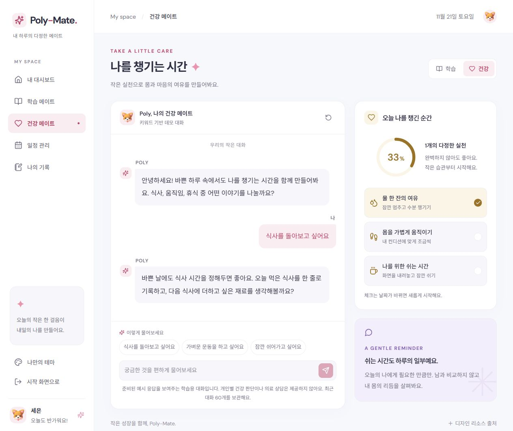
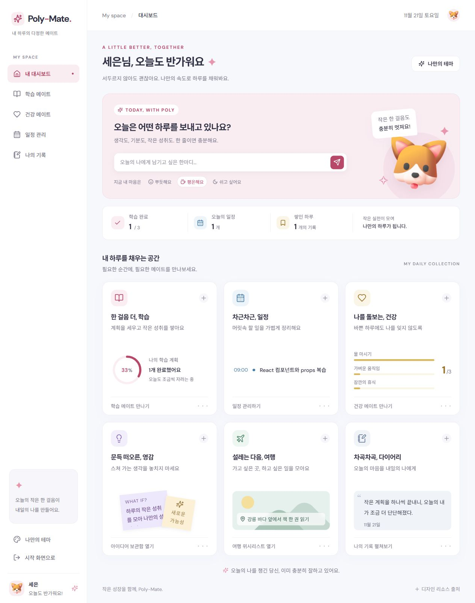
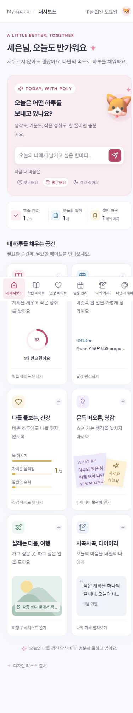

<div align="center">


# Poly-Mate

### 내 하루의 다정한 메이트

배움도, 일상도, 잠깐의 쉼도.<br />
흩어진 하루를 한곳에 모으고, 나만의 속도로 자라나는 공간.

<p>
  
  
  
  
</p>

[**웹사이트 둘러보기**](https://seeun-jang.github.io/ThePolyMate/) · [**빠른 시작**](#-빠른-시작) · [**구현 설명**](docs/IMPLEMENTATION.md)

[](https://github.com/seeun-jang/ThePolyMate/actions/workflows/deploy-pages.yml)

</div>

<br />


## 🌷 작은 성장이 모이는 공간

**Poly-Mate**는 사용자의 배움과 일상을 함께 정리하는 개인 대시보드입니다. 1학기 HTML·CSS·JavaScript로 제작한 홈페이지의 정체성을 이어, 대표 **5페이지를 React 함수형 컴포넌트로 재구현**했습니다.

코기 캐릭터와 파스텔 색감은 유지하면서, 기록을 꺼내 읽는 흐름과 일정 관리, 학습 완료율, 모바일 화면을 보완했습니다. 설정과 기록은 브라우저에 저장되어 새로고침 후에도 이어집니다.

| 공간                      | 함께할 수 있는 일                                                          |
| ------------------------- | -------------------------------------------------------------------------- |
| 📚 **한 걸음 더, 학습**   | 학습 계획 추가·완료·삭제, 완료한 계획에 따른 성취도, 키워드 기반 학습 대화 |
| 🗓️ **차근차근, 일정**     | 날짜·시간별 일정 추가·조회·수정·완료·삭제, 시간순 정렬                     |
| 🌿 **나를 돌보는, 건강**  | 물·움직임·휴식 체크, 날짜별 루틴, 생활 습관을 돌아보는 예시 대화           |
| 💡 **문득 떠오른, 영감**  | 아이디어 메모 추가·수정·삭제, 보관함과 파일 내려받기                       |
| 🧳 **설레는 다음, 여행**  | 가고 싶은 곳과 하고 싶은 일을 모으는 여행 위시리스트                       |
| 📖 **차곡차곡, 다이어리** | 기분과 한 줄 기록 저장, 지난 기록 조회·수정·삭제·내려받기                  |

## 🖼️ 화면 미리보기

실제 React 실행 화면입니다. 캡처에는 동작 확인을 위해 입력한 시연 기록이 포함되어 있습니다.

<table>
  <tr>
    <td width="50%" align="center"><strong>나의 공간에 들어가기</strong><br /><br /></td>
    <td width="50%" align="center"><strong>학습 메이트</strong><br /><br /></td>
  </tr>
  <tr>
    <td width="50%" align="center"><strong>건강 메이트</strong><br /><br /></td>
    <td width="50%" align="center"><strong>나만의 테마</strong><br /><br /></td>
  </tr>
</table>

<details>
<summary><strong>대시보드 전체 화면 보기</strong></summary>
<br />



</details>

<details>
<summary><strong>모바일 화면 보기</strong></summary>
<br />

<p align="center"></p>

</details>

## 🎨 오늘의 기분에 맞는 세 가지 테마

| 포근한 집 · Cozy Home       | 기분 좋은 여행 · Fresh Journey | 고요한 우주 · Midnight Space |
| --------------------------- | ------------------------------ | ---------------------------- |
| 로즈와 라벤더의 편안한 공간 | 초록빛과 맑은 하늘의 산뜻함    | 깊은 밤과 별빛을 담은 차분함 |

선택한 테마는 모든 페이지에 적용되고 자동 저장됩니다. 데스크톱에서는 사이드바와 3열 카드, 모바일에서는 하단 메뉴와 2열 카드로 탐색합니다. 학습 상세는 작은 화면에서 위아래로 배치됩니다.

## 🚀 빠른 시작

**Node.js 22.12 이상**이 필요합니다.

```bash
git clone https://github.com/seeun-jang/ThePolyMate.git
cd ThePolyMate
npm ci
npm run dev
```

터미널에 표시되는 주소를 엽니다. 기본 주소는 `http://127.0.0.1:5173`입니다. Windows에서는 저장소의 **`preview.cmd`**를 실행해 시작할 수도 있습니다.

| 명령              | 하는 일                    |
| ----------------- | -------------------------- |
| `npm run dev`     | 개발 서버 실행             |
| `npm test`        | 데이터 동작 테스트 실행    |
| `npm run build`   | `dist/`에 배포용 파일 생성 |
| `npm run preview` | 빌드 결과를 로컬에서 확인  |
| `npm run format`  | 코드 서식 정리             |

## ⚛️ React로 바뀐 점

| 이전 구현                       | React 구현                                                        |
| ------------------------------- | ----------------------------------------------------------------- |
| 화면 요소를 찾아 직접 추가·변경 | 상태에 따라 JSX로 화면 렌더링                                     |
| 페이지마다 반복하던 화면 요소   | `Layout`, `Modal`, `FeatureIcon`, `ProgressRing` 등 공통 컴포넌트 |
| DOM 이벤트와 목록 재생성        | 입력 상태·이벤트 핸들러·고유 ID를 사용한 목록 렌더링              |
| 페이지별 테마 적용 코드         | `App`의 공통 테마 상태와 props 전달                               |
| 고정된 성취도 예시              | 실제 완료한 학습 계획 비율 계산                                   |

**`useState`**로 입력·목록·창 열림 상태를 관리하고, **`useEffect`**로 저장소와 타이머를 연결합니다. **`useRef`**는 입력 포커스와 채팅 스크롤에, 사용자 정의 Hook **`useRoute`·`useClock`**은 페이지 이동과 날짜 갱신에 사용합니다.

```text
ThePolyMate/
├─ src/
│  ├─ App.jsx              공통 상태·저장·페이지 연결
│  ├─ pages/               시작·로그인·대시보드·학습·테마 5페이지
│  ├─ components/          레이아웃·모달·보관함·공통 UI
│  ├─ lib/                 데이터 검증·정렬·예시 응답·Hook
│  └─ styles.css           반응형 스타일과 세 가지 테마
├─ public/                 아이콘과 이전 주소 연결 페이지
├─ tests/                  데이터 동작 테스트
├─ docs/                   구현 설명과 실행 화면 캡처
├─ legacy/                 1학기 정적 홈페이지 원본
└─ .github/workflows/      테스트·빌드·GitHub Pages 배포
```

[페이지별 주소와 세부 구현 설명 보기](docs/IMPLEMENTATION.md)

## 🧪 확인한 동작

- 데이터 테스트 **10개 통과**: 기존 저장 데이터 이전, 손상된 데이터 처리, 저장 실패 대응, 일정 제한·정렬, 완료율 계산 등.
- 프로덕션 빌드 성공, 브라우저 실행 오류 확인.
- 로그인 입력 검증, 일정 추가·수정·완료 처리, 기록 추가·삭제, 학습 체크와 대화, 테마 적용 및 새로고침 후 유지 확인.
- 모바일 **320px·390px** 너비의 가로 넘침 확인, 하단 메뉴와 카드 배치 보완.
- 키보드 포커스 표시, 모달의 Escape 닫기·포커스 복귀, 배경 `inert` 처리, 모션 감소 설정 대응.

## ☁️ 배포와 원본 보존

`main`에 푸시하면 GitHub Actions에서 **의존성 설치 → 테스트 → 빌드 → GitHub Pages 배포**를 실행합니다. 배포 상태는 상단 배지 또는 [Actions](https://github.com/seeun-jang/ThePolyMate/actions)에서 확인할 수 있습니다.

- **React 웹사이트**: https://seeun-jang.github.io/ThePolyMate/
- **1학기 원본 화면**: https://seeun-jang.github.io/ThePolyMate/legacy/
- **원본 소스**: [`legacy/`](legacy/)

기존 `main.html`, `login.html`, `learning.html`, `theme.html` 주소도 해당 React 화면으로 연결합니다. 해시 주소를 사용해 상세 화면에서 새로고침해도 경로를 유지합니다.

## 📝 웹프로그래밍활용 기말 프로젝트

| 항목                  | 내용                                                            |
| --------------------- | --------------------------------------------------------------- |
| 제작자                | 한국폴리텍대학 서울정수캠퍼스 · 인공지능소프트웨어학과 · 장세은 |
| 학번                  | 2601110299                                                      |
| 주제                  | 1학기 홈페이지 대표 5페이지의 React 함수형 컴포넌트 재구현      |
| 메인 개발 저장소      | [ThePolyMate](https://github.com/seeun-jang/ThePolyMate)        |
| 수업·과제 제출 저장소 | [Web2Projects](https://github.com/seeun-jang/Web2Projects)      |
| 필수 커밋 문구        | `★ 기말고사과제 ★`                                              |

과제 제출 시에는 수업 저장소에도 검증한 소스를 별도 폴더로 반영하고, **화면 캡처·구현 기술·UI 편의성을 설명한 PDF 보고서**를 제출합니다. 표지에는 제목·GitHub 주소·교과목명·담당교수·학과명·학번·성명을 기재하고 날짜는 넣지 않습니다. 제공된 공지의 마감은 **2026년 12월 10일 23:59**입니다.

## 💬 구현 범위와 데이터

이 프로젝트의 로그인은 **입력 검증을 포함한 시연 기능**이며, 실제 계정 인증을 제공하지 않습니다. 비밀번호는 저장하거나 전송하지 않습니다. 대화는 **준비된 키워드에 반응하는 데모**이고 외부 생성형 AI API를 호출하지 않습니다. 학습 완료율은 계획 체크의 비율이며, 건강 기능은 생활 습관 기록용입니다.

기록과 설정은 이 브라우저의 `localStorage`에 저장됩니다. 일정 12개, 각 보관함 20개, 주제별 최근 메시지 60개를 보관합니다. 기존 저장 항목은 같은 출처에서 새 데이터 구조로 가져오며 원본 키는 삭제하지 않습니다. 브라우저나 기기가 바뀌면 기록이 공유되지 않으므로 보관함의 JSON 내려받기를 이용할 수 있습니다.

## 🤍 리소스와 참고

- 원본 디자인·홈페이지: [ThePolyMate 1학기 버전](legacy/README.md)
- 코기 및 기존 아이콘: [Freepik / Flaticon](https://www.flaticon.com/authors/freepik)
- 원본 테마 아이콘: Lizel Arina / Flaticon · Isometric 아이콘: vectorsmarket15 / Flaticon
- 선 아이콘: [Lucide](https://lucide.dev) — ISC License
- 글꼴: Noto Sans KR·DM Sans / Google Fonts — SIL Open Font License
- 개발 참고: [React 공식 문서](https://react.dev/learn/thinking-in-react) · [Vite 정적 배포](https://vite.dev/guide/static-deploy)

---

<p align="center">작은 성장을 함께, <strong>Poly-Mate.</strong></p>
