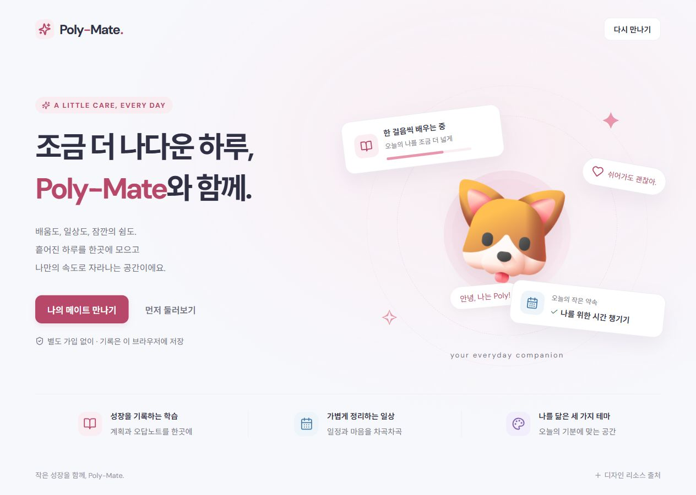

# Poly-Mate

**배움과 일상을 함께 챙기는, 내 하루의 다정한 메이트.**

Poly-Mate는 공부할 일, 잊지 말아야 할 약속, 문득 떠오른 생각과 오늘의 마음을 한곳에 모으는 개인 대시보드입니다. 친근한 코기 메이트 Poly와 함께 나만의 속도로 하루를 정리하고, 작은 실천을 차곡차곡 기록할 수 있습니다.

**[Poly-Mate 웹사이트 열기](https://seeun-jang.github.io/ThePolyMate/)**



## 어떤 공간인가요?

하루를 보내다 보면 공부할 내용은 메모장에, 일정은 달력에, 떠오른 아이디어는 다른 곳에 흩어지곤 합니다. Poly-Mate는 이런 일상의 조각들을 여섯 가지 공간으로 모아, 필요한 순간에 쉽게 꺼내 볼 수 있도록 만들었습니다.

오늘 끝낸 학습 계획에 체크하고, 다음 약속을 정리하고, 하루를 마치며 짧은 기록을 남겨보세요. 큰 성과가 없는 날에도 나를 챙긴 작은 순간을 돌아볼 수 있는 공간입니다.

## 내 하루를 채우는 여섯 가지 공간

| 공간         | 이렇게 사용해요                                                                                                                                    |
| ------------ | -------------------------------------------------------------------------------------------------------------------------------------------------- |
| **학습**     | 공부할 내용을 작은 계획으로 나누고 완료한 항목을 체크해요. 얼마나 실천했는지 완료율로 확인하고, 학습 메이트와 준비된 주제의 대화를 나눌 수 있어요. |
| **일정**     | 날짜와 시간을 정해 약속이나 할 일을 추가해요. 일정이 바뀌면 수정하고, 끝낸 일은 완료로 표시하거나 정리할 수 있어요.                                |
| **건강**     | 물 마시기, 가볍게 움직이기, 쉬는 시간처럼 일상에서 나를 돌보는 습관을 체크해요. 체크는 매일 새롭게 시작해요.                                       |
| **영감**     | 만들고 싶은 것, 발견한 것, 문득 떠오른 아이디어를 메모해요. 정리되지 않은 생각도 보관해두었다가 다시 꺼내 볼 수 있어요.                            |
| **여행**     | 가고 싶은 장소와 그곳에서 하고 싶은 일을 적어요. 나만의 여행 위시리스트를 조금씩 채울 수 있어요.                                                   |
| **다이어리** | 지금의 기분과 함께 오늘의 한 줄을 남겨요. 지난 기록을 읽고 수정하거나, 파일로 내려받아 간직할 수 있어요.                                           |

<details>
<summary>대시보드 전체 화면 보기</summary>


</details>

## 이렇게 시작해보세요

1. 웹사이트에서 **먼저 둘러보기**를 선택해 가볍게 들어와요.
2. 대시보드에서 지금 필요한 공간을 골라요. 학습 계획 하나나 오늘의 약속 하나부터 시작해도 좋아요.
3. **오늘의 한 줄**에 기억하고 싶은 순간을 적고, 지금의 기분도 함께 남겨요.
4. **나만의 테마**에서 편안한 분위기를 골라 내 공간을 꾸며요.

## 오늘의 기분에 맞는 분위기

| 포근한 집                   | 기분 좋은 여행                  | 고요한 우주                       |
| --------------------------- | ------------------------------- | --------------------------------- |
| 로즈와 라벤더의 편안한 색감 | 초록빛과 하늘빛의 산뜻한 분위기 | 깊은 밤과 별빛을 담은 차분한 공간 |

선택한 테마는 모든 화면에 함께 적용되고 다음 방문에도 유지됩니다. 컴퓨터에서는 넓은 대시보드로, 휴대폰에서는 하단 메뉴로 각 공간을 이용할 수 있습니다.

<details>
<summary>로그인 · 학습 · 건강 · 테마 화면 보기</summary>

| 로그인                                             | 학습                                                       |
| -------------------------------------------------- | ---------------------------------------------------------- |
|       |  |
| **건강**                                           | **테마 선택**                                              |
|  |           |

</details>

<details>
<summary>모바일 화면 보기</summary>


</details>

화면 캡처의 기록은 기능을 보여주기 위해 입력한 예시입니다.

## 이용 안내

- **별도 회원가입 없이 둘러볼 수 있어요.** 현재 로그인은 이름을 기억하고 화면을 시작하는 체험 기능으로, 실제 계정 인증은 제공하지 않습니다. 입력한 비밀번호는 저장하거나 전송하지 않습니다.
- **기록은 사용 중인 브라우저에 저장돼요.** 같은 브라우저에서는 새로고침 후에도 이어서 볼 수 있지만, 다른 기기나 브라우저로 자동 동기화되지는 않습니다. 브라우저 데이터를 삭제하면 기록도 삭제될 수 있습니다.
- **소중한 기록은 파일로 간직할 수 있어요.** 다이어리·영감·여행 보관함의 내려받기를 이용하면 저장한 내용을 JSON 파일로 보관할 수 있습니다.
- **메이트 대화는 준비된 주제에 반응해요.** 학습과 생활 습관에 관한 키워드 기반 예시 응답을 제공합니다. 외부 생성형 AI 연결, 개인별 건강 판단, 실시간 여행 검색이나 예약 기능은 제공하지 않습니다.

## 개발 정보

React와 JavaScript로 화면과 기능을 구성하고, CSS로 세 가지 테마와 반응형 화면을 구현했습니다. 기록과 설정은 브라우저의 localStorage에 저장하며, GitHub Pages에서 서비스합니다.

<details>
<summary>내 컴퓨터에서 실행하기</summary>

Node.js 22.12 이상이 필요합니다.

```bash
git clone https://github.com/seeun-jang/ThePolyMate.git
cd ThePolyMate
npm ci
npm run dev
```

터미널에 표시되는 주소를 열면 됩니다. Windows에서는 `preview.cmd`를 실행할 수도 있습니다.

`npm test`로 데이터 동작을 확인하고, `npm run build`로 배포용 파일을 생성합니다.

</details>

## 만든 사람

[장세은](https://github.com/seeun-jang)

<details>
<summary>디자인 리소스 출처</summary>

- 코기와 기존 아이콘: [Freepik / Flaticon](https://www.flaticon.com/authors/freepik)
- 투톤 메뉴·카드 아이콘: 프로젝트 내 SVG로 제작
- 보조 선 아이콘: [Lucide](https://lucide.dev), ISC License
- 원본 테마 아이콘: Lizel Arina / Flaticon · Isometric 아이콘: vectorsmarket15 / Flaticon
- 글꼴: Noto Sans KR·DM Sans / Google Fonts, SIL Open Font License

</details>
