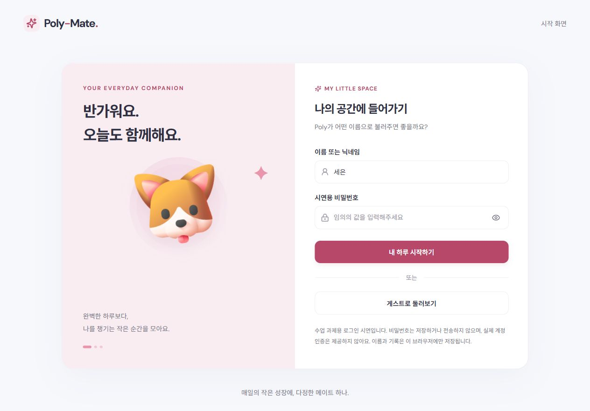
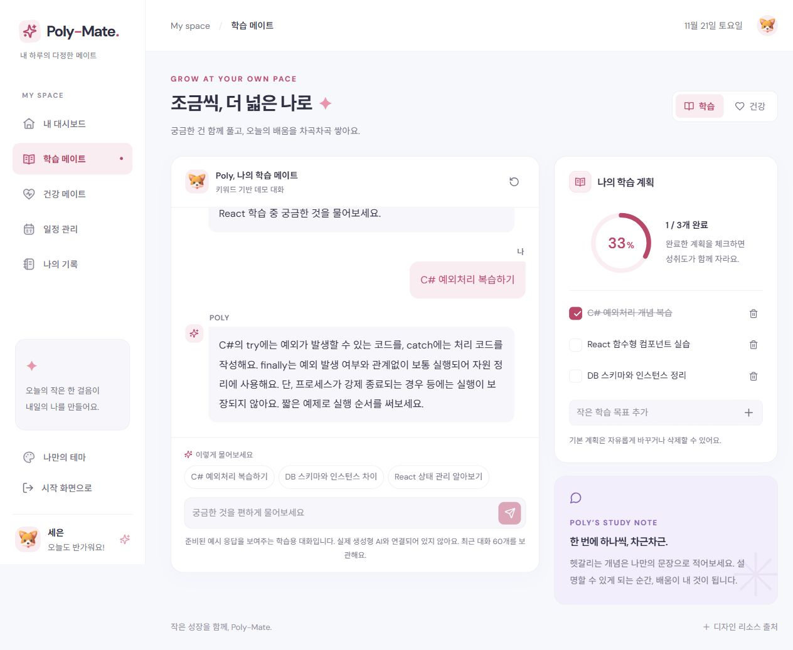
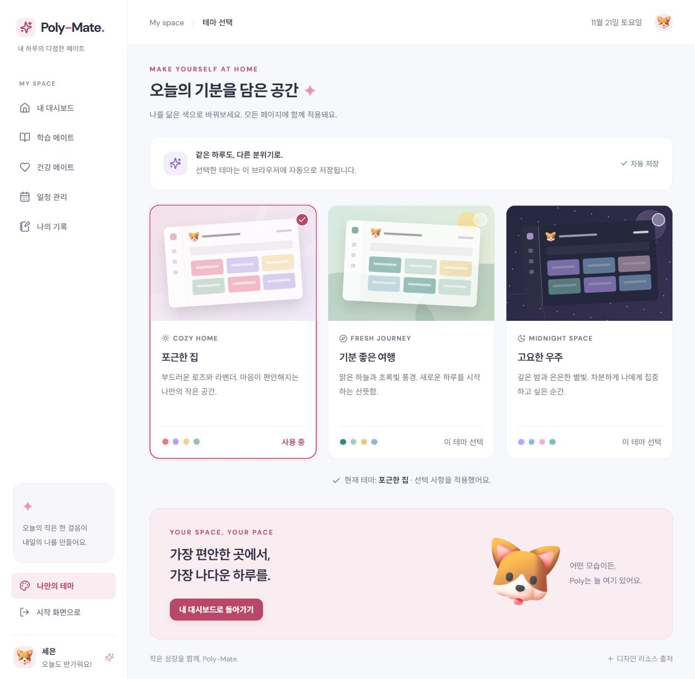

# Poly-Mate

학습 계획과 일정을 정리하고, 오늘의 마음을 기록하는 나만의 공간입니다.

**[Poly-Mate 웹사이트 열기](https://seeun-jang.github.io/ThePolyMate/)**


## 주요 기능

| 기능     | 할 수 있는 일                                   |
| -------- | ----------------------------------------------- |
| 학습     | 학습 계획을 만들고, 완료한 만큼 성취도 확인하기 |
| 일정     | 날짜와 시간별 일정 추가·수정·완료·삭제하기      |
| 건강     | 물 마시기·움직임·휴식 등 오늘의 습관 체크하기   |
| 영감     | 떠오른 아이디어를 메모하고 다시 꺼내 보기       |
| 여행     | 가고 싶은 곳과 하고 싶은 일을 모아 두기         |
| 다이어리 | 기분과 한 줄 기록을 저장하고 지난 기록 읽기     |

포근한 집·기분 좋은 여행·고요한 우주 중 원하는 테마를 선택할 수 있습니다. 기록과 설정은 사용 중인 브라우저에 저장됩니다. 휴대폰에서도 이용할 수 있습니다.

## 화면 보기

<details>
<summary>대시보드</summary>


</details>

<details>
<summary>로그인 · 학습 · 건강 · 테마 선택</summary>

| 로그인                                        | 학습                                              |
| --------------------------------------------- | ------------------------------------------------- |
|  |     |
| **건강**                                      | **테마 선택**                                     |
|  |  |

</details>

<details>
<summary>모바일</summary>


</details>

캡처에는 기능 확인을 위해 입력한 시연 기록이 포함되어 있습니다.

## 내 컴퓨터에서 실행하기

Node.js 22.12 이상을 설치한 뒤 실행합니다.

```bash
git clone https://github.com/seeun-jang/ThePolyMate.git
cd ThePolyMate
npm ci
npm run dev
```

터미널에 표시되는 주소를 열면 됩니다. Windows에서는 `preview.cmd`를 실행할 수도 있습니다.

## 프로젝트 소개

웹프로그래밍활용 기말 프로젝트로, 1학기에 만든 홈페이지의 **시작·로그인·대시보드·학습 상세·테마 선택 5페이지**를 React 함수형 컴포넌트로 다시 구현했습니다.

| 항목      | 내용                                                        |
| --------- | ----------------------------------------------------------- |
| 제작자    | 한국폴리텍대학 서울정수캠퍼스 인공지능소프트웨어학과 장세은 |
| 학번      | 2601110299                                                  |
| 사용 기술 | React, Vite, JavaScript, CSS, localStorage                  |
| 검증      | 데이터 테스트 10개 통과, 배포용 빌드 및 모바일 화면 확인    |

기존 정적 홈페이지는 [`legacy/`](legacy/)에 보존했습니다. [1학기 원본 화면](https://seeun-jang.github.io/ThePolyMate/legacy/)도 볼 수 있습니다.

로그인과 대화는 수업용 시연 기능입니다. 비밀번호는 저장·전송하지 않으며, 대화는 외부 AI 연결 없이 준비된 키워드에 반응합니다.

<details>
<summary>구현 구조 · 테스트 · 배포 · 제출 안내</summary>

- [페이지 구성과 React 구현 설명](docs/IMPLEMENTATION.md)
- `npm test`: 데이터 동작 테스트
- `npm run build`: 배포용 파일 생성
- `npm run preview`: 빌드 결과 확인
- `main`에 푸시하면 테스트·빌드 후 GitHub Pages에 자동 배포됩니다.
- 수업 제출 저장소는 [Web2Projects](https://github.com/seeun-jang/Web2Projects)입니다. 필수 커밋 문구는 `★ 기말고사과제 ★`이며, 화면 캡처와 구현 설명을 포함한 PDF 보고서를 함께 제출합니다.

</details>

<details>
<summary>디자인 리소스 출처</summary>

- 코기와 기존 아이콘: [Freepik / Flaticon](https://www.flaticon.com/authors/freepik)
- 원본 테마 아이콘: Lizel Arina / Flaticon · Isometric 아이콘: vectorsmarket15 / Flaticon
- 선 아이콘: [Lucide](https://lucide.dev), ISC License
- 글꼴: Noto Sans KR·DM Sans / Google Fonts, SIL Open Font License
- [1학기 프로젝트 설명](legacy/README.md)

</details>
